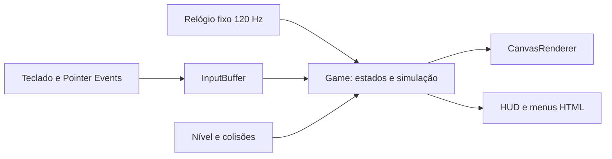

# ARCADE COLLECTION / Barrel Quest

Primeira versão jogável, **local**, de Barrel Quest. Ember-7 sobe cinco pisos,
recolhe cargas e evita barris. Código em TypeScript, Canvas 2D e arte própria.
Nenhum repositório remoto ou GitHub Pages foi criado para este projeto.

## Executar

Requer **Node.js 22 ou posterior** e npm. Na pasta do projeto:

```powershell
cd C:\Projetos\arcade-collection
npm ci
npm run dev
```

Abra [http://127.0.0.1:4173/](http://127.0.0.1:4173/). Para encerrar, Ctrl+C no
terminal. `npm run dev` compila e serve localmente, sem hot reload: após editar
fontes, execute `npm run build` e atualize a página. Se a porta estiver ocupada:

```powershell
$env:PORT=4174
npm run dev
```

Uma compilação já existente pode ser servida com `npm start`. Abrir `index.html`
diretamente por `file://` não é o fluxo suportado, por causa dos módulos ES.

## Jogar

| Controle | Ação |
| --- | --- |
| Setas esquerda/direita ou A/D | Andar e correr |
| Setas cima/baixo ou W/S | Subir/descer quando estiver junto de uma escada |
| Espaço | Pular; solte antes do próximo salto |
| P ou Escape | Pausar/continuar enquanto o foco estiver no jogo |
| Botões na tela | Segure a direção; toque PULAR. Multitoque permite ambas as ações |

Escolha **Jogar agora**. Recolha as cinco cargas douradas e chegue à bandeira
no último piso. Barris e quedas tiram uma das três vidas. O retorno usa o
último andar alcançado, preserva cargas e pontos e oferece 1,8 s de proteção
contra barris. Cair para fora do cenário continua custando uma vida.

Pule em movimento para passar sobre os barris. A pontuação é exclusivamente
da partida: **250 por carga**, **100 por saltar um barril e pousar em segurança**,
**500 pela vitória**. Não há pontos por tempo ou simples movimento. Isso não
representa commits ou contribuições do GitHub.

Menus de instruções, pausa, vitória e Game Over são HTML acessível; é possível
reiniciar sem recarregar. Sair da janela ou ocultar a aba pausa automaticamente.
O foco volta ao Canvas ao iniciar/continuar. As teclas de jogo não interceptam
campos de formulário e os botões preservam ativação nativa por teclado.

Em telas estreitas, uma câmera acompanha Ember-7: o mundo e a física são os
mesmos, com maior tamanho aparente do personagem. `prefers-reduced-motion`
ativa **Reduzir efeitos visuais**, congelando ciclos cosméticos e rotação de
barris; o movimento necessário para jogar e a câmera continuam ativos. Não há
pisca-pisca ou tremor de tela. Pausar congela completamente a partida.

## Testes

```powershell
npm test
npm run test:browser
```

`npm test` compila e executa testes no runner nativo do Node. A QA de navegador
usa Chrome instalado e Playwright, já fixado no lockfile. Para Firefox:

```powershell
npx playwright install firefox
$env:ARCADE_BROWSER='firefox'
npm run test:browser
```

A QA automatizada usa eventos reais de teclado/toque no DOM e o relógio RAF
do Playwright. O observador `?qa=1` existe apenas em localhost e fornece cópias
somente para leitura; não permite mudar vidas, posições ou placar. Os testes
unitários também incluem uma missão inteira com barris ativos e entradas normais.

## Arquitetura



| Módulo | Responsabilidade |
| --- | --- |
| `src/core/game.ts` | Estados, vidas, checkpoint, barris, entregas e eventos de pontuação |
| `src/core/level.ts` | Geometria, escadas e constantes de física |
| `src/core/collision.ts` | Colisão varrida entre barril e corpo do personagem |
| `src/core/clock.ts` | Acumulador de passo fixo, limitado após travamentos de aba |
| `src/core/input.ts` | Ações independentes da origem e borda de salto preservada |
| `src/browser/controls.ts` | Teclado, multitoque, cancelamento, blur e eventos DOM |
| `src/render/` | Ember-7, cenário, barris e câmera; não altera o estado |
| `src/app.ts` | Orquestração, RAF, foco, menus HTML e preferências |
| `public/` | Interface, CSS e favicon próprios |
| `scripts/` | Build e servidor local com biblioteca padrão do Node |
| `tests/` | Física, estados, controles, replay completo e QA de navegador |

Não há dependências de execução, engine de terceiros, fontes remotas, áudio,
telemetria, backend, tokens, storage de usuário ou requisições autenticadas.
TypeScript e Playwright são dependências de desenvolvimento com versões fixas.

## Auditoria, arte e publicação futura

- [Auditoria do perfil e plano de implementação](docs/AUDIT.md)
- [Origem e autoria da arte](docs/PROVENANCE.md)
- [Validação e capturas observadas](docs/VALIDATION.md)

`npm run build` produz `dist/` com URLs relativas, sem roteamento de SPA e
com `.nojekyll`. O mesmo conteúdo funciona em um subcaminho como
`/arcade-collection/`. Está preparado para hospedagem estática futura, mas
**não existe workflow de deploy nem remoto configurado**.

Antes de publicar: aprovar o projeto local, autorizar a criação de
`PedroCostinha/arcade-collection`, escolher a licença do código próprio e
aprovar separadamente a configuração do Pages. A mudança do README do perfil
para apontar ao jogo só deve acontecer após existir uma URL aprovada e funcional.
O CODE QUEST V2 e os SVGs do perfil não foram alterados nesta implementação.
