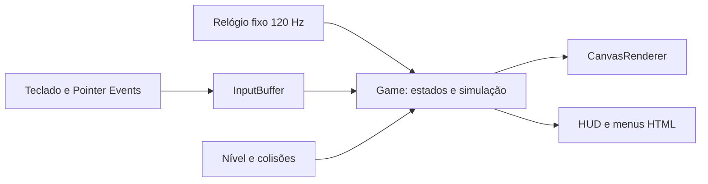

# ARCADE COLLECTION / Barrel Quest

**Barrel Quest `1.1.0` preparado; merge e publicação pendentes no Draft PR #1.** Corrige salto
por repetição de Espaço após pausa, painéis em telas intermediárias e feedback
de objetivo, dano e checkpoint. A física e a arte do protótipo foram preservadas.
Veja [a análise, os testes e as comparações antes/depois](docs/REVIEW_V1_1.md).

Primeira versão jogável de Barrel Quest, executável **localmente**. Ember-7 sobe cinco pisos,
recolhe cargas e evita barris. Código em TypeScript, Canvas 2D e arte própria.
Repositório público: [PedroCostinha/arcade-collection](https://github.com/PedroCostinha/arcade-collection).
**GitHub Pages desativado.** O código está disponível para revisão; não há URL
de jogo hospedado nesta etapa.

## Executar

Requer **Node.js 22 ou posterior** e npm. Na pasta do projeto:

```powershell
git clone https://github.com/PedroCostinha/arcade-collection.git
cd arcade-collection
git switch feat/barrel-quest-playable
npm ci
npm run dev
```

Abra [http://127.0.0.1:4173/](http://127.0.0.1:4173/). Para encerrar, Ctrl+C no
terminal. `npm run dev` compila e serve localmente, sem hot reload: após editar
fontes, execute `npm run build` e atualize a página. Se a porta estiver ocupada:

```powershell
$env:PORT=4174
npm run dev
```

Uma compilação já existente pode ser servida com `npm start`. Abrir `index.html`
diretamente por `file://` não é o fluxo suportado, por causa dos módulos ES.

## Jogar

| Controle | Ação |
| --- | --- |
| Setas esquerda/direita ou A/D | Andar e correr |
| Setas cima/baixo ou W/S | Subir/descer quando estiver junto de uma escada |
| Espaço | Pular; solte antes do próximo salto |
| P ou Escape | Pausar/continuar enquanto o foco estiver no jogo |
| Botões na tela | Segure a direção; toque PULAR. Multitoque permite ambas as ações |

Escolha **Jogar agora**. Recolha as cinco cargas douradas e chegue à bandeira
no último piso. Barris e quedas tiram uma das três vidas. O retorno usa o
último andar alcançado, preserva cargas e pontos e oferece 1,8 s de proteção
contra barris. Cair para fora do cenário continua custando uma vida.

Pule em movimento para passar sobre os barris. A pontuação é exclusivamente
da partida: **250 por carga**, **100 por saltar um barril e pousar em segurança**,
**500 pela vitória**. Não há pontos por tempo ou simples movimento. Isso não
representa commits ou contribuições do GitHub.

Menus de instruções, pausa, vitória e Game Over são HTML acessível; é possível
reiniciar sem recarregar. Sair da janela ou ocultar a aba pausa automaticamente.
O foco volta ao Canvas ao iniciar/continuar. As teclas de jogo não interceptam
campos de formulário e os botões preservam ativação nativa por teclado.

Uma faixa abaixo do cenário informa dano, checkpoint, retorno e pontos. Após
três segundos de partida, ela volta a indicar a próxima carga pendente ou a
bandeira final. As mensagens também usam `role=status`; não há flashes ou
animação adicional. Nas instruções, aproxime-se da escada e segure W/S ou ↑/↓;
solte para parar, ou pressione Espaço para sair saltando.

Em telas estreitas, uma câmera acompanha Ember-7: o mundo e a física são os
mesmos, com maior tamanho aparente do personagem. `prefers-reduced-motion`
ativa **Reduzir efeitos visuais**, congelando ciclos cosméticos e rotação de
barris; o movimento necessário para jogar e a câmera continuam ativos. Não há
pisca-pisca ou tremor de tela. Pausar congela completamente a partida.

## Testes

```powershell
npm test
npm run test:browser
```

`npm test` compila e executa testes no runner nativo do Node. A QA de navegador
usa Chrome instalado e Playwright, já fixado no lockfile. Para Firefox:

```powershell
npx playwright install firefox
$env:ARCADE_BROWSER='firefox'
npm run test:browser
```

A QA automatizada usa eventos reais de teclado/toque no DOM e o relógio RAF
do Playwright. O observador `?qa=1` existe apenas em localhost e fornece cópias
somente para leitura; não permite mudar vidas, posições ou placar. Os testes
unitários também incluem uma missão inteira com barris ativos e entradas normais.

O CI compila e executa a suíte de testes em Node 22 e 24, além da missão completa
em Firefox no Linux. As Actions estão fixadas por SHA, com `contents: read`,
sem credenciais persistidas, secrets ou permissões de deploy. Evidências de CI
ficam em `test-results/`, sem alterar as capturas de referência versionadas.
Para usar esse destino localmente, defina `ARCADE_EVIDENCE_DIR` antes da QA.

A preparação de publicação inclui testes de artefato/subcaminho e comparação
com 32 sequências de desenho da RC e os escopos de licença (29 testes no total). Os checks de
`629322d` cobrem os 25 anteriores; os checks da preparação precisam passar
no próprio SHA enviado ao PR. Veja o [relatório atual](docs/PREPARATION_1_1_0.md).

## Arquitetura



| Módulo | Responsabilidade |
| --- | --- |
| `src/core/game.ts` | Estados, vidas, checkpoint, barris, entregas e eventos de pontuação |
| `src/core/level.ts` | Geometria, escadas e constantes de física |
| `src/core/collision.ts` | Colisão varrida entre barril e corpo do personagem |
| `src/core/clock.ts` | Acumulador de passo fixo, limitado após travamentos de aba |
| `src/core/input.ts` | Ações independentes da origem e borda de salto preservada |
| `src/browser/controls.ts` | Teclado, multitoque, cancelamento, blur e eventos DOM |
| `src/render/` | Ember-7, cenário, barris e câmera; não altera o estado |
| `src/art/` | Dados artísticos reservados: sprites, paleta, composição e identidade |
| `src/app.ts` | Orquestração, RAF, foco, menus HTML e preferências |
| `public/` | Interface, CSS e favicon próprios |
| `scripts/` | Build e servidor local com biblioteca padrão do Node |
| `tests/` | Física, estados, controles, replay completo e QA de navegador |

Não há dependências de execução, engine de terceiros, fontes remotas, áudio,
telemetria, backend, tokens, storage de usuário ou requisições autenticadas.
TypeScript e Playwright são dependências de desenvolvimento com versões fixas.

## Auditoria, arte e publicação futura

- [Auditoria do perfil e plano de implementação](docs/AUDIT.md)
- [Origem e autoria da arte](docs/PROVENANCE.md)
- [Validação e capturas observadas](docs/VALIDATION.md)
- [Preparação do repositório e CI](docs/REPOSITORY_SETUP.md)
- [Licenças e inventário por recurso](LICENSING.md)
- [Origem da decisão de licenciamento](docs/LICENSING.md)
- [Changelog](CHANGELOG.md)
- [Plano de publicação, aprovação e checklist hospedado](docs/RELEASE_PLAN_1_1_0.md)

`npm run build` produz `dist/` com URLs relativas, sem roteamento de SPA e
com `.nojekyll`. O mesmo conteúdo funciona em um subcaminho como
`/arcade-collection/`. O workflow preparado em `.github/workflows/pages.yml`
aceita apenas disparo
manual da `main`, confirmação expressa, SHA completo correspondente e versão
`1.1.0`. Não há publicação em push, PR, tag ou release. A branch de
preparação não passa no gate de ref. **Pages permanece desativado e este
workflow não foi executado.** Só `dist/` será enviado após aprovação.

O titular aprovou MIT **somente para o código original**, com direitos
reservados para Ember-7, sprites, arte e identidade. Leia os escopos em
[LICENSING.md](LICENSING.md), a [MIT](LICENSE-CODE.txt) e os
[direitos da arte](ART-RIGHTS.txt). O pacote misto não é integralmente MIT.
O build distribui os três avisos, acessíveis pelo crédito no rodapé, e usa
apenas módulos/assets locais. `private: true` continua impedindo publicação npm.

Estão autorizados o commit de preparação e o push normal nesta branch;
integração, configuração/publicação Pages e tag/release continuam sem
autorização. O PR permanece Draft para aprovação final, inclusive após CI.
O CODE QUEST V2, os SVGs e o repositório do perfil não foram alterados.
